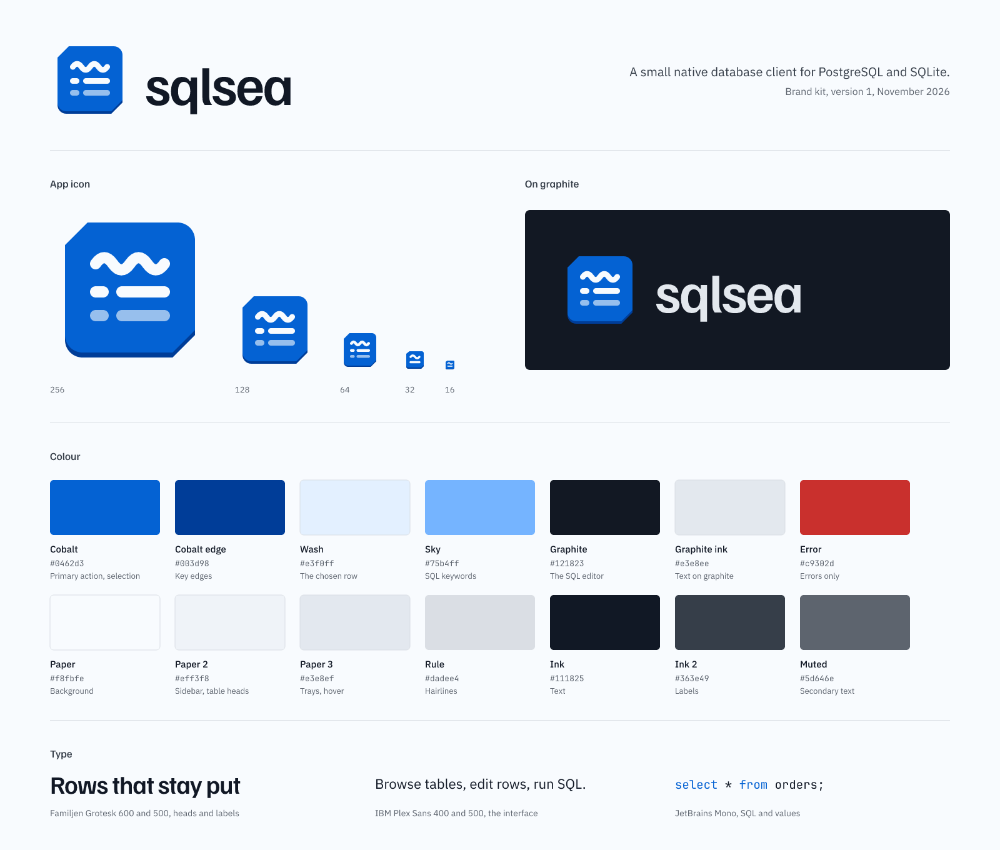

# sqlsea brand kit



## The mark

A wave over two table rows: the sea, then the data. It sits on a key with two cut corners and a darker bottom edge, the same keycap the app's buttons use.

The app icon is drawn twice. `icon.svg` is the full drawing, for 48 px and up. `icon-small.svg` drops a row and thickens the strokes for 16 to 32 px, where three rows would blur together.

## Files

Edit the sources in `source/`, then rebuild everything with:

```sh
cargo run --example brand
```

That writes `svg/` (text turned into outlines, so the files look right without the fonts installed) and `png/`.

| Asset | Use | Files |
| --- | --- | --- |
| App icon | Launchers, the window, the docs | `svg/icon.svg`, `png/icon-16.png` to `icon-1024.png` |
| Lockup | The README, the website, slides | `svg/lockup.svg`, `png/lockup-528.png`, `png/lockup-1056.png` |
| Lockup on dark | On graphite or any dark ground | `svg/lockup-dark.svg` and PNGs |
| Lockup in one colour | Print, engraving, single-ink | `svg/lockup-mono.svg` and PNGs |
| Wordmark | Where the icon already appears nearby | `svg/wordmark.svg` and PNGs |
| Mark | The glyph without its key, on light grounds | `svg/mark.svg`, `svg/mark-mono.svg` and PNGs |
| Social preview | The repository card, link previews | `png/social-1280.png` |
| Brand sheet | Everything on one page | `png/sheet-1600.png` |

## Using it

- **Clear space:** keep the height of one table row of the mark (about a seventh of the icon) clear on every side.
- **Smallest sizes:** the lockup at 96 px wide; the icon at 16 px, using the small drawing.
- **The name** is always lower case, `sqlsea`, in Familjen Grotesk 600 with slightly tight spacing (−0.028 em).
- **The tile stays cobalt** on light and dark grounds. Use the one-colour lockup only where colour cannot print.

Do not:

- recolour the tile, or put the cobalt tile on a cobalt ground;
- add gradients, shadows or outlines to the mark;
- stretch, rotate or round the cut corners;
- set the name in another face, in capitals, or with the icon below it.

## Colour

Cobalt is the one signal: in the app it marks the primary action, the chosen row and state, and nothing else. The neutrals lean slightly blue.

| Name | Hex | Role |
| --- | --- | --- |
| Cobalt | `#0462d3` | Primary action, selection, the tile |
| Cobalt edge | `#003d98` | Key edges |
| Wash | `#e3f0ff` | The chosen row, changed fields |
| Sky | `#75b4ff` | SQL keywords on graphite |
| Graphite | `#121823` | The SQL editor, dark grounds |
| Graphite ink | `#e3e8ee` | Text on graphite |
| Error | `#c9302d` | Errors only |
| Paper | `#f8fbfe` | Background |
| Paper 2 | `#eff3f8` | Sidebar, table heads |
| Paper 3 | `#e3e8ef` | Trays, hover |
| Rule | `#dadee4` | Hairlines |
| Ink | `#111825` | Text |
| Ink 2 | `#363e49` | Labels |
| Muted | `#5d646e` | Secondary text |

The app reads these from `src/theme.rs`; change them there and in `source/` together.

## Type

- **Familjen Grotesk** 600 for the name and headings, 500 for labels.
- **IBM Plex Sans** 400 and 500 for interface text.
- **JetBrains Mono** for SQL and data values, never for labels.

All three are under the SIL Open Font License; the files and licences are in `assets/fonts`.
